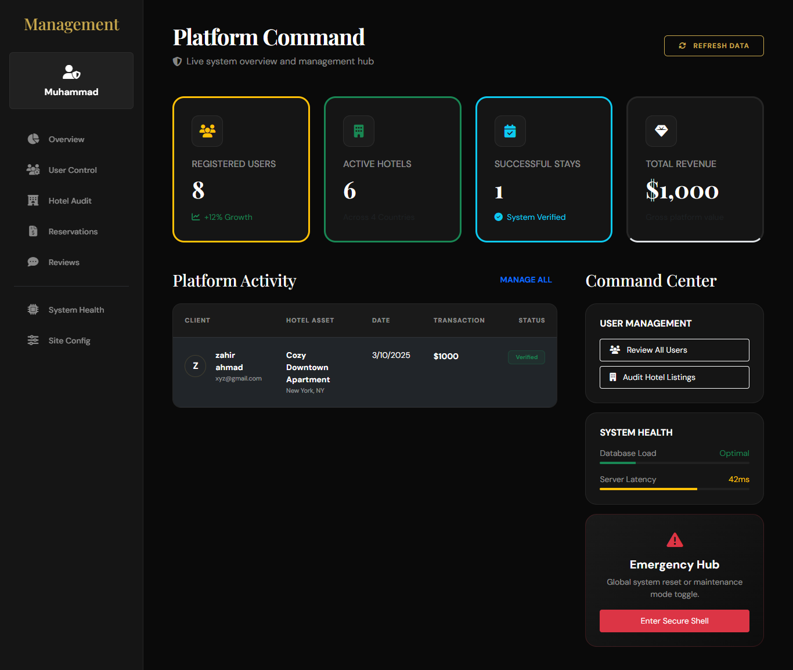
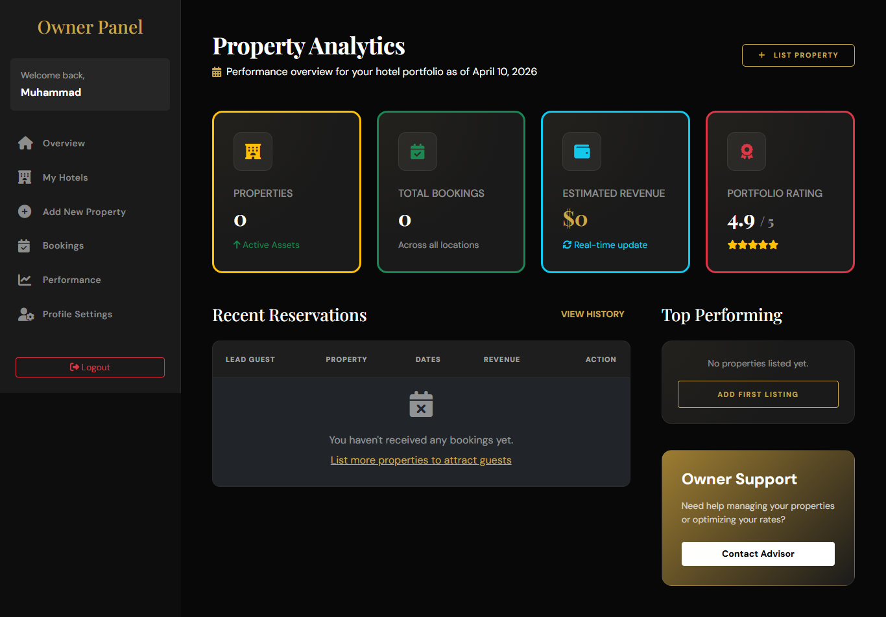

# 🏨 InstaStay – Luxury Hotel Booking Platform

**InstaStay** is a premium, high-contrast digital sanctuary for travelers and hotel owners. Built with a focus on luxury aesthetics and seamless functionality, it provides a comprehensive suite for searching, booking, and managing elite accommodations.

---

## 📸 Screenshots

### 🖥️ Admin Control Center
Manage the entire platform with a high-tech administrative dashboard.


### 🏨 Owner Dashboard
Track bookings, manage listings, and monitor revenue with a clean, glassmorphism interface.


### ✍️ Premium Blog
Stay updated with luxury travel tips and culinary insights through our modern grid-based blog.


---

## 🚀 Key Features

- ✅ **Luxury UI/UX** – High-contrast dark theme with glassmorphism and premium typography (Playfair Display & DM Sans).
- ✅ **Multi-Role Access** – Dynamic dashboards for Admin (System Audit), Owner (Property Management), and Customer (Bookings).
- ✅ **Advanced Search & Filter** – Effortlessly find hotels by type, availability, and location.
- ✅ **Real-time Geolocation** – Interactive maps powered by Leaflet.js for property discovery.
- ✅ **Secure Authentication** – Robust user sessions via Passport.js.
- ✅ **Inventory Management** – Real-time tracking of room availability and reservation statuses.
- ✅ **Brand Consistency** – Fully unified brand identity under the InstaStay name.

---

## 🛠️ Tech Stack

### **Frontend**
- **EJS** – Server-side templating for dynamic content rendering.
- **Vanilla CSS3** – Custom-built premium design system with modern glassmorphism effects.
- **JavaScript (ES6+)** – Interactive features and responsive UI logic.
- **FontAwesome** – Professional iconography.

### **Backend**
- **Node.js & Express.js** – High-performance server-side logic and RESTful API handling.
- **MongoDB Atlas** – Scalable cloud-based NoSQL database.
- **Passport.js** – Secure authentication and session management.
- **Cloudinary** – Optimized image hosting and management.

---

## 📂 Installation & Setup

### **1️⃣ Clone the Repository**
```bash
git clone https://github.com/Khalil-dev144/InstaStay-project.git
cd InstaStay-project
```

### **2️⃣ Install Dependencies**
```bash
npm install
```

### **3️⃣ Set Up Environment Variables**
Create a `.env` file in the root directory and add your credentials:
```env
MONGO_ATLAS_URL="your_mongodb_cluster_url"
CLOUD_NAME="your_cloudinary_name"
CLOUD_API_KEY="your_api_key"
CLOUD_API_SECRET="your_api_secret"
LEAFLET_TOKEN="your_leaflet_token"
```

### **4️⃣ Initialize Database (Optional)**
If you want to seed the database with sample data:
```bash
node init/index.js
```

### **5️⃣ Start the Server**
```bash
npm start
# or for development
nodemon index.js
```
The application will be live at **http://localhost:3000/** 🎉

---

## 🌍 Live Demo
Experience the platform live: 🔗 [View InstaStay Live](https://insta-stay-project.vercel.app/listings)  

---

## 🤝 Contributing
Contributions make the world go round!
1. Fork the repo.
2. Create your branch (`git checkout -b feature/AmazingFeature`).
3. Commit your changes (`git commit -m 'Add some AmazingFeature'`).
4. Push to the branch (`git push origin feature/AmazingFeature`).
5. Open a Pull Request.

---

## 📧 Contact
For support or business inquiries:
📩 **Email:** muhammadkhalil.web@gmail.com  
🔗 **LinkedIn:** [Khalil Dev](https://www.linkedin.com/in/khalil-dev/)  

---

### ⭐ Show your support by starring this repository! ⭐
